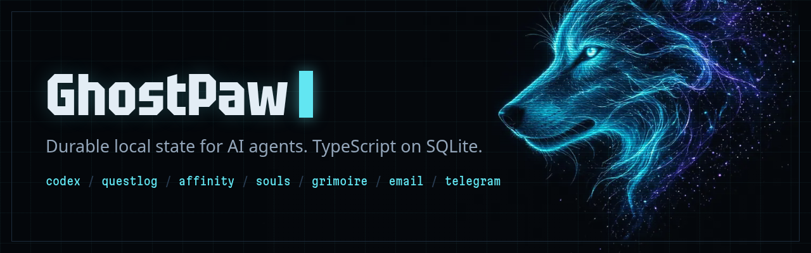

<a href="https://ghostpaw.dev/"></a>

Seven small TypeScript libraries that give an AI agent a place to keep its state: what it believes, what it has to do, who it knows, who it is, what it has learned, and the two channels it talks through. Each one stores plain records in a SQLite file you can open, inspect and delete.

They are built for agents that run on their own for days. When an agent saves a wrong fact, marks a task done without doing it, or rewrites its own prompt, the record shows it and the change can be undone.

## Libraries

| Library | Keeps | What it does |
|---|---|---|
| [**codex**](https://github.com/GhostPawJS/codex)<br><sub>[site](https://codex.ghostpaw.dev/) · [npm](https://www.npmjs.com/package/@ghostpaw/codex)</sub> | Memory | Beliefs with a source, a certainty and a revision history. Stale or weakly evidenced beliefs are flagged.<br>`npm i @ghostpaw/codex` |
| [**questlog**](https://github.com/GhostPawJS/questlog)<br><sub>[site](https://questlog.ghostpaw.dev/) · [npm](https://www.npmjs.com/package/@ghostpaw/questlog)</sub> | Tasks | Quests, deadlines, scheduled windows and RRULE repeats. A quest finishes only with a written outcome.<br>`npm i @ghostpaw/questlog` |
| [**affinity**](https://github.com/GhostPawJS/affinity)<br><sub>[site](https://affinity.ghostpaw.dev/) · [npm](https://www.npmjs.com/package/@ghostpaw/affinity)</sub> | Contacts | People, identities, promises and yearly dates, with a radar for relationships that are drifting.<br>`npm i @ghostpaw/affinity` |
| [**souls**](https://github.com/GhostPawJS/souls)<br><sub>[site](https://souls.ghostpaw.dev/) · [npm](https://www.npmjs.com/package/@ghostpaw/souls)</sub> | Identity | A prompt kept as an essence plus evidence-backed traits. Refinement waits until evidence agrees; every change rolls back.<br>`npm i @ghostpaw/souls` |
| [**grimoire**](https://github.com/GhostPawJS/grimoire)<br><sub>[site](https://grimoire.ghostpaw.dev/) · [npm](https://www.npmjs.com/package/@ghostpaw/grimoire)</sub> | Skills | SKILL.md folders whose improvements are sealed as git commits, with evidence notes, a health check and rollback.<br>`npm i @ghostpaw/grimoire` |
| [**email**](https://github.com/GhostPawJS/email)<br><sub>[site](https://email.ghostpaw.dev/) · [npm](https://www.npmjs.com/package/@ghostpaw/email)</sub> | Email | IMAP sync and SMTP send in-process, with a SQLite cache, threads and FTS5 search. Reading and sending are separate tools.<br>`npm i @ghostpaw/email` |
| [**telegram**](https://github.com/GhostPawJS/telegram)<br><sub>[site](https://telegram.ghostpaw.dev/) · [npm](https://www.npmjs.com/package/@ghostpaw/telegram)</sub> | Telegram | Every bot update mirrored into SQLite before your handler runs, with edit history, files and search. Agent tools return plans by default.<br>`npm i @ghostpaw/telegram` |

## How they fit together

- **No shared core.** The packages never import each other. Your agent's code carries data from one to the next, and each library keeps its own tables. Install one and ignore the rest.
- **Same runtime.** Node.js 24 or newer and its built-in `node:sqlite`. Zero runtime dependencies, MIT licence.
- **Four ways in.** A library import, a stdio MCP server, a `ghostpaw-<name>` command line tool, and an Agent Skill. All four are generated from the same tool definitions.
- **State you can find.** The MCP servers default to `~/.ghostpaw/<name>.db`. grimoire also keeps its SKILL.md files in a git folder.

```bash
npm install @ghostpaw/codex          # use it as a library
npx -y @ghostpaw/codex mcp           # or run it as an MCP server
```

Every server is listed in the [MCP Registry](https://registry.modelcontextprotocol.io/v0.1/servers?search=io.github.GhostPawJS) under `io.github.GhostPawJS/<name>`.

## Links

[ghostpaw.dev](https://ghostpaw.dev/) · [llms.txt](https://ghostpaw.dev/llms.txt) · [npm @ghostpaw](https://www.npmjs.com/org/ghostpaw) · [Contributing](https://github.com/GhostPawJS/.github/blob/main/CONTRIBUTING.md) · [Security](https://github.com/GhostPawJS/.github/blob/main/SECURITY.md) · [Support](https://github.com/GhostPawJS/.github/blob/main/SUPPORT.md)
